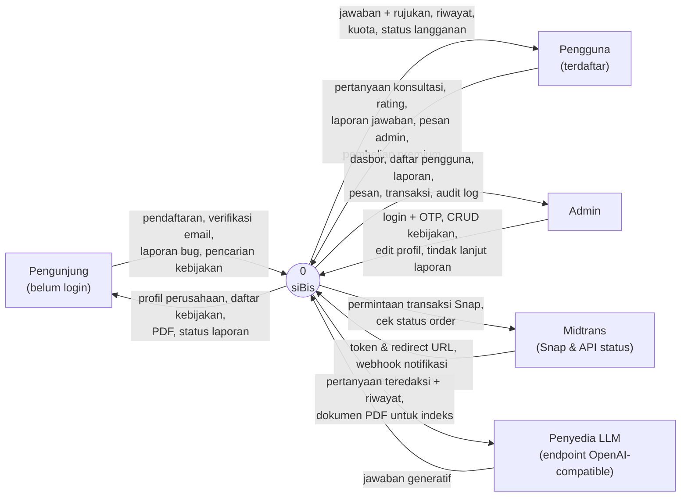
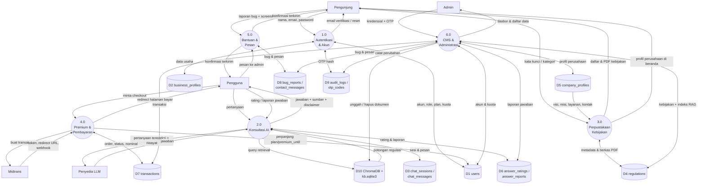
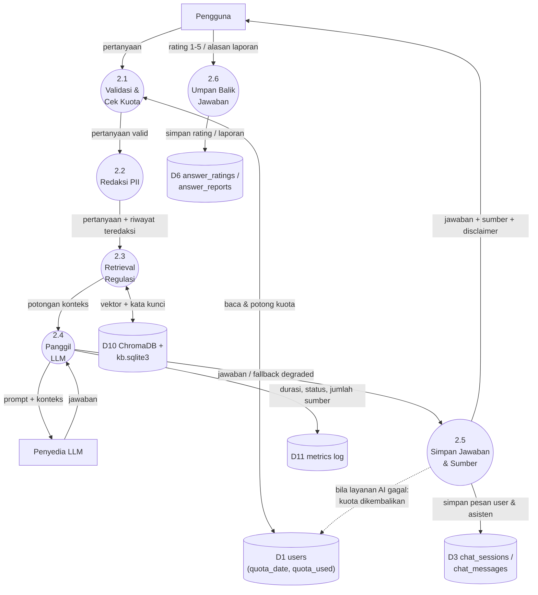
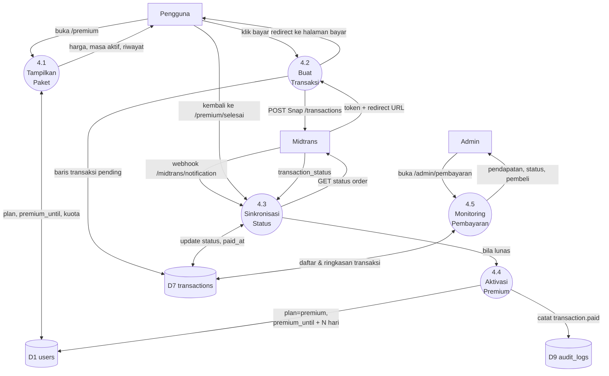

# Data Flow Diagram siBis

Diagram ini menggambarkan implementasi final (bukan rancangan awal). Notasi
mengikuti Yourdon/DeMarco: proses (lingkaran), entitas eksternal (kotak),
data store (garis sejajar), dan arus data (panah berlabel).

Sumber kebenaran: `backend/routes/web.php`, `backend/app/Http/Controllers/*`,
`backend/app/Models/*`, dan `ai-service/app.py`.

---

## 1. DFD Level 0 — Diagram Konteks

siBis sebagai satu proses besar yang bertukar data dengan lima entitas luar.

Catatan: layanan RAG (FastAPI) adalah bagian internal sistem, sehingga tidak
digambar sebagai entitas luar. Batas kepercayaan yang sebenarnya adalah
Laravel → FastAPI (token internal) dan FastAPI → penyedia LLM.

---

## 2. DFD Level 1 — Proses Utama

---

## 3. DFD Level 2 — Proses 2.0 Konsultasi AI

Proses paling kompleks karena melibatkan kuota, redaksi PII, retrieval, dan
penanganan kegagalan layanan AI.

Aturan penting pada Level 2:

| Kondisi | Perilaku |
|---|---|
| Kuota habis | Pertanyaan ditolak, tidak ada panggilan LLM |
| Layanan AI gagal/timeout | Jawaban `degraded`, `quota_used` dikembalikan |
| PII terdeteksi | Diganti `[email]`, `[telepon]`, `[nik]`, `[npwp]` pada salinan yang dikirim |
| Riwayat panjang | Hanya 4 pesan terakhir, maksimal 400 karakter per pesan |

---

## 4. DFD Level 2 — Proses 4.0 Premium & Pembayaran

Aturan idempotensi: premium hanya diaktifkan saat transaksi berubah dari
belum-lunas menjadi lunas. Webhook berulang tidak menambah masa aktif lagi.

---

## 5. Kamus Data

### 5.1 Entitas luar

| Entitas | Peran |
|---|---|
| Pengunjung | Belum login; dapat membaca kebijakan, konsultasi (mode tamu), mendaftar, dan mengirim laporan bug/pesan |
| Pengguna | Akun terverifikasi; konsultasi, riwayat, premium, pesan admin |
| Admin | Akun `role=admin` dengan OTP; mengelola konten dan menindaklanjuti laporan |
| Midtrans | Payment gateway (Snap sandbox/produksi) |
| Penyedia LLM | Endpoint kompatibel OpenAI yang dipanggil layanan RAG |

### 5.2 Data store

| Kode | Tabel / media | Isi | Pemilik proses |
|---|---|---|---|
| D1 | `users` | Akun, role, plan, premium_until, kuota harian, two_factor_at | 1.0, 2.0, 4.0, 6.0 |
| D2 | `business_profiles` | Nama usaha, jenis, kota | 1.0 |
| D3 | `chat_sessions`, `chat_messages` | Sesi konsultasi (akun/tamu), pesan, sumber, flag degraded | 2.0 |
| D4 | `regulations` | Metadata kebijakan, berkas PDF, `rag_doc_id` | 3.0, 6.0 |
| D5 | `company_profiles` | Visi, misi, layanan, kontak publik | 3.0, 6.0 |
| D6 | `answer_ratings`, `answer_reports` | Nilai 1–5, alasan laporan, status tindak lanjut (akun/tamu) | 2.0, 6.0 |
| D7 | `transactions` | Order Midtrans, nominal, status, `paid_at`, respons mentah | 4.0, 6.0 |
| D8 | `bug_reports`, `contact_messages` | Laporan bug + screenshot, pesan pengguna | 5.0, 6.0 |
| D9 | `audit_logs`, `otp_codes` | Jejak perubahan konten, OTP admin (hash) | 1.0, 4.0, 6.0 |
| D10 | ChromaDB + `kb.sqlite3` | Indeks vektor & kata kunci dokumen kebijakan | 2.0, 3.0, 6.0 |
| D11 | `storage/logs/metrics-*.log` | Metrik JSON: status, durasi, jumlah sumber | 2.0 |

### 5.3 Arus data kunci

| Arus | Dari → Ke | Muatan |
|---|---|---|
| Pertanyaan konsultasi | Pengguna → 2.1 | Teks 3–1000 karakter |
| Prompt LLM | 2.4 → LLM | Pertanyaan teredaksi + maks. 4 pesan riwayat |
| Jawaban AI | 2.4 → 2.5 | Teks jawaban, daftar sumber, flag degraded |
| Notifikasi Midtrans | Midtrans → 4.3 | `order_id`, `transaction_status`, `gross_amount`, `signature_key` |
| Aktivasi premium | 4.4 → D1 | `plan=premium`, `premium_until` baru |
| Audit perubahan | 6.0 → D9 | `actor_id`, `action`, `subject`, metadata |

---

## 6. Batas Kepercayaan dan Kontrol

| Batas | Kontrol |
|---|---|
| Publik → aplikasi | CSRF token, validasi request, throttle form bantuan (5/menit) |
| Pengguna → area admin | Middleware `auth`, `verified`, `admin`; OTP wajib segar (30 menit) |
| Laravel → FastAPI | `Authorization: Bearer <RAG_TOKEN>`; FastAPI menolak 401 tanpa token |
| FastAPI → LLM | Hanya teks pertanyaan teredaksi; tanpa nama/email/profil usaha |
| Midtrans → aplikasi | Signature SHA-512 diverifikasi; order tak dikenal diabaikan |
| Aplikasi → publik | Security headers + CSP nonce; PDF & screenshot lewat disk `public` |
