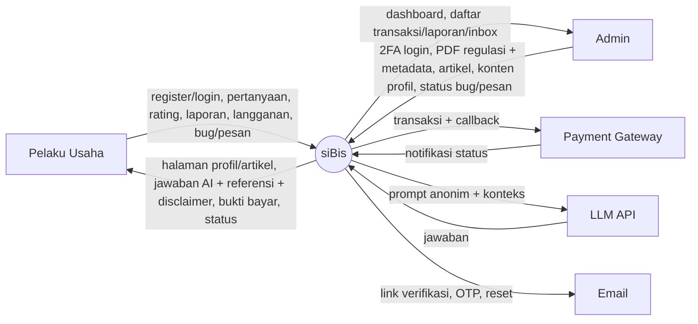
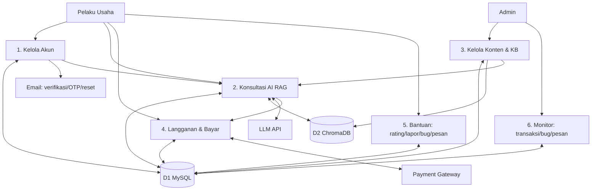
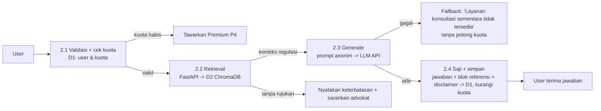

# DFD siBis — dari SRS (tanpa SDD)

Diturunkan teliti dari RF-01..21 + UC-01..24. SDD contoh (SATSET) tidak dipakai.

## DFD Level 0 — Diagram Konteks

Entitas luar: **Pelaku Usaha (User)**, **Admin**, **Payment Gateway**, **LLM API**, **Layanan Email**.
Sistem: **siBis**.

Aliran kunci: User wajib login untuk chat/premium/bug/pesan (UC-07/12/21/22). Admin wajib 2FA OTP (UC-03). Data ke LLM anonim (NFR-16).

## DFD Level 1 — Proses utama

Data store: **D1 MySQL** (akun, chat, artikel, transaksi, profil, bug/pesan), **D2 ChromaDB** (embedding hukum).

- P1 = UC-01/02/03/04/05/06 (RF-10..13). Lock brute-force, OTP admin, cabut sesi lama, hapus data UU PDP.
- P2 = UC-07/08/09/10/11 (RF-05/06). Detail di Level 2.
- P3 = UC-14/15/16/17/18 (RF-14..18). Upload PDF → ekstrak → chunk → indeks D2. CRUD artikel + edit profil CMS.
- P4 = UC-12/13 (RF-07/21). Buat transaksi → gateway → notifikasi → aktif kuota. Admin sinkron ulang.
- P5 = UC-10/11/21/22 + UC-19/20 publik (RF-01..04/08/09).
- P6 = UC-13/23/24 (RF-19/20/21). Status bug Baru/Proses/Selesai, pesan baca/belum.

## DFD Level 2 — P2 Konsultasi AI (inti)

Aturan dari SRS: kuota dicek dulu (UC-07). Gagal AI = coba lagi tanpa potong kuota. Tanpa rujukan KB = jangan mengarang, tampilkan keterbatasan. Tiap jawaban: ringkasan awam + dasar hukum (nama+nomor+tahun) + disclaimer edukasi. Log req/res + latensi tanpa data sensitif (NFR-18/19).

## Traceability singkat
RF-01→P5/P3, RF-02/03/04→P5, RF-05/06→P2, RF-07→P4, RF-08→P5/P6, RF-09→P5/P6, RF-10..13→P1, RF-14/15/16→P3, RF-17→P3, RF-18→P3, RF-19/20→P6, RF-21→P4/P6.
