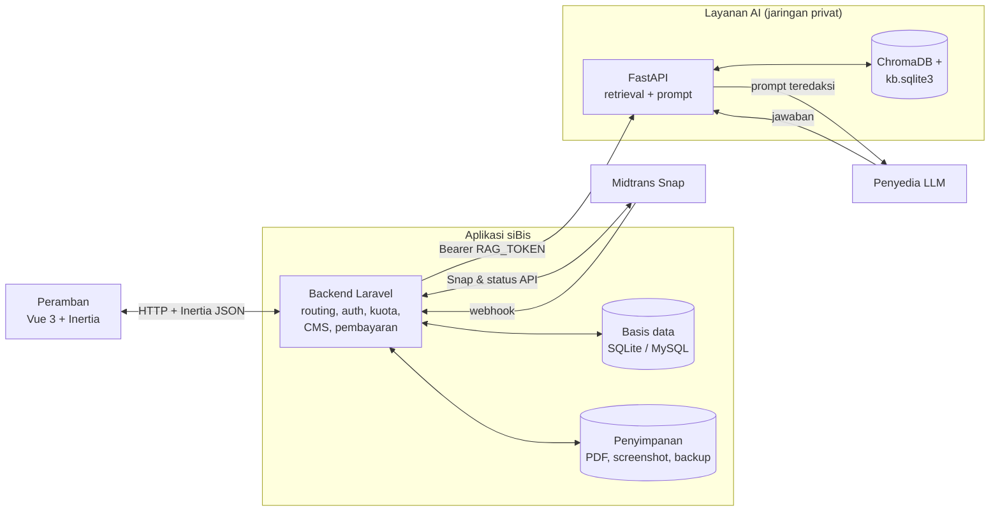
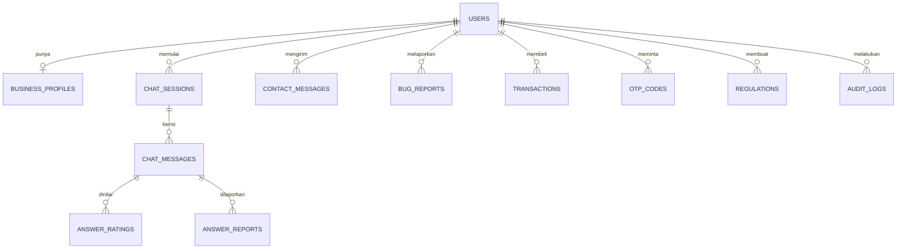
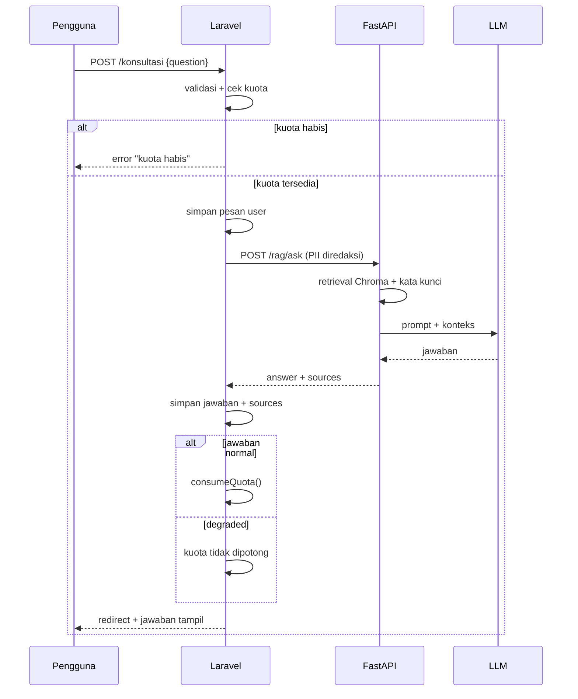
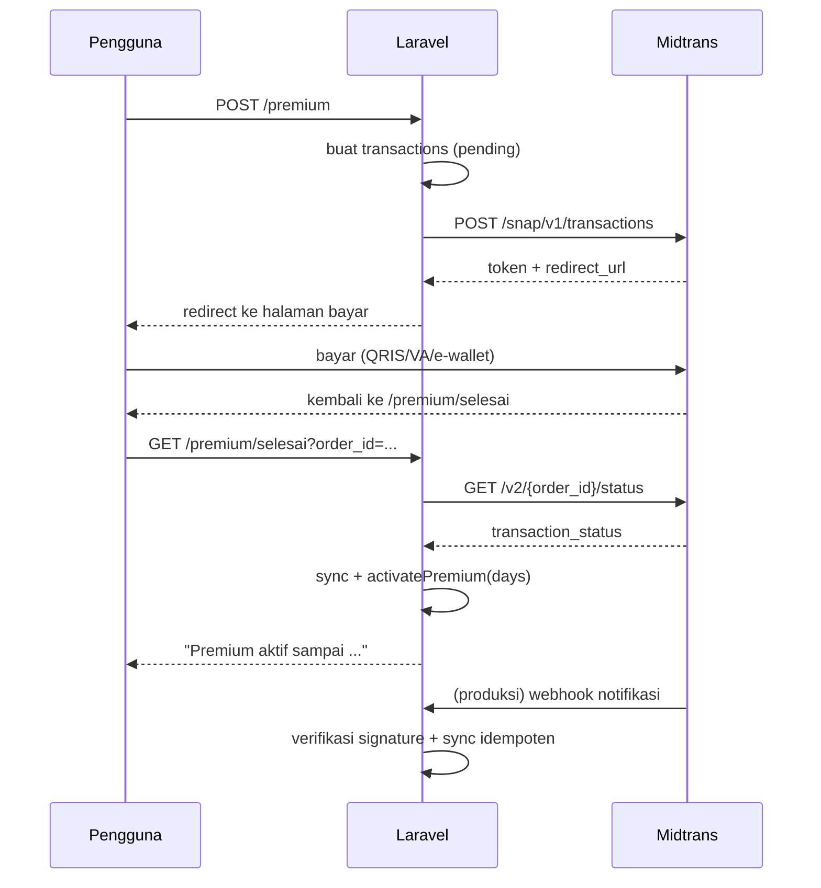
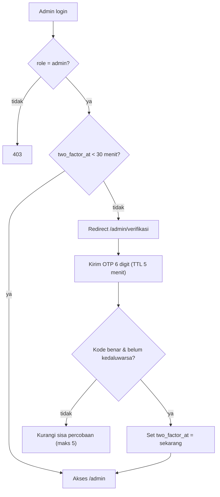

# Spesifikasi Kebutuhan Perangkat Lunak (SRS)
## siBis — Sistem Informasi Konsultasi Hukum Bisnis Berbasis AI

| | |
|---|---|
| Versi | 2.0 (final) |
| Tanggal | 18 November 2026 |
| Status | Disetujui sebagai acuan implementasi final |
| Menggantikan | `SRS_11241029.pdf` (arsip, versi 1.0) |
| Lingkup | Aplikasi web siBis beserta layanan AI dan integrasi pembayaran |

> Dokumen ini ditulis ulang berdasarkan kode yang benar-benar berjalan, bukan
> rancangan awal. Setiap kebutuhan fungsional (RF), use case (UC), dan kebutuhan
> non-fungsional (NFR) dapat ditelusuri ke berkas implementasi dan pengujian.
> Perbedaan terhadap SRS lama dicatat eksplisit di Bagian 8.

---

## 1. Pendahuluan

### 1.1 Tujuan

Dokumen ini menetapkan kebutuhan perangkat lunak siBis secara lengkap dan
dapat diuji: apa yang harus dilakukan sistem, siapa penggunanya, bagaimana
sistem dibangun, dan bagaimana pemenuhannya dibuktikan. Dokumen ditujukan
kepada pengembang, penguji, dosen pembimbing, dan pemilik produk.

### 1.2 Ruang lingkup

**Termasuk:**

- Situs publik: profil perusahaan, daftar & pencarian kebijakan PDF, detail
  kebijakan.
- Akun: registrasi, verifikasi email, login/logout, reset password, hapus akun.
- Konsultasi AI: tanya-jawab dengan rujukan regulasi, kuota harian, riwayat,
  penilaian, dan pelaporan jawaban. Tamu (tanpa akun) boleh mencoba dengan
  kuota 5/hari dan riwayat berbasis cookie 30 hari.
- Langganan premium: pembayaran Midtrans, aktivasi otomatis, monitoring admin.
  Halaman paket dapat dilihat tamu; pembelian tetap wajib akun.
- Bantuan: laporan bug (publik) dan pesan ke admin (publik; tamu mengisi
  nama+email).
- Area admin: OTP dua faktor, CMS kebijakan PDF, CMS profil perusahaan,
  tindak lanjut laporan, kotak masuk, monitoring pembayaran, audit log.
- Operasional: backup harian, metrik LLM, health check, redaksi PII.

**Tidak termasuk:**

- Aplikasi seluler native.
- Nasihat hukum mengikat; keluaran AI adalah edukasi awal.
- Akuntansi/pembukuan, integrasi OSS pajak, atau e-signature.
- Multi-tenant/multi-perusahaan dalam satu instalasi.

### 1.3 Definisi dan singkatan

| Istilah | Arti |
|---|---|
| RF | Requirement Fungsional |
| UC | Use Case |
| NFR | Non-Functional Requirement |
| RAG | Retrieval-Augmented Generation: ambil dokumen relevan lalu minta LLM menjawab |
| LLM | Large Language Model |
| Snap | Halaman pembayaran hosted Midtrans |
| OTP | One-Time Password untuk verifikasi admin |
| PII | Personally Identifiable Information |
| CSP | Content Security Policy |
| WCAG | Web Content Accessibility Guidelines |
| HSTS | HTTP Strict Transport Security |
| SRS | Software Requirements Specification |

### 1.4 Referensi

1. `docs/DFD.md` — DFD Level 0–2 dan kamus data.
2. `docs/GAP_ANALYSIS.md` — audit SRS lama vs kode, checklist RF/UC/NFR.
3. `docs/MIDTRANS.md` — konfigurasi dan alur pembayaran.
4. `docs/OPERASIONAL.md` — backup, metrik, health check, PII.
5. `SRS_11241029.pdf` — SRS versi 1.0 (arsip).
6. UU No. 27 Tahun 2022 tentang Pelindungan Data Pribadi.
7. WCAG 2.1 Level AA.

### 1.5 Ikhtisar dokumen

Bagian 2 menjelaskan sistem secara umum. Bagian 3 memuat arsitektur dan
rancangan data. Bagian 4–6 memuat RF, UC, dan NFR. Bagian 7 menyediakan
matriks ketertelusuran. Bagian 8 mencatat keputusan desain dan deviasi.
Bagian 9 menjelaskan pengujian dan kriteria penerimaan. Bagian 10 berisi
lampiran operasional.

---

## 2. Deskripsi Umum Sistem

### 2.1 Perspektif produk

siBis adalah aplikasi web mandiri (bukan produk turunan) yang terdiri dari tiga
komponen yang dideploy bersama:

1. **Backend Laravel** — logika bisnis, autentikasi, basis data, dan penyajian
   halaman melalui Inertia.
2. **Frontend Vue 3** — antarmuka pengguna, dibangun Vite, hasil build masuk ke
   direktori publik Laravel.
3. **Layanan AI FastAPI** — pengindeksan PDF, retrieval, dan pemanggilan LLM.
   Bersifat opsional saat pengembangan: bila mati, aplikasi tetap berjalan
   dengan jawaban fallback.

Midtrans bertindak sebagai penyedia pembayaran eksternal; penyedia LLM
(kompatibel OpenAI) dipanggil hanya oleh layanan AI.

### 2.2 Fungsi produk

| Kelompok | Fungsi |
|---|---|
| Publik | Profil perusahaan, daftar/cari/detail kebijakan PDF, lapor bug, pesan ke admin |
| Akun | Registrasi, verifikasi email, login, logout, reset password, hapus akun |
| Konsultasi | Tanya AI (akun atau tamu), rujukan sumber, kuota, riwayat, hapus riwayat, rating, lapor jawaban |
| Premium | Halaman paket (publik), checkout Midtrans, aktivasi otomatis, riwayat pembayaran |
| Bantuan | Pesan ke admin, kotak masuk admin, tindak lanjut laporan bug |
| Admin | OTP, dasbor, pengguna, CMS kebijakan, CMS profil, laporan, pembayaran, audit |
| Operasional | Backup harian, prune retensi, metrik LLM, health check, redaksi PII |

### 2.3 Kelas pengguna

| Aktor | Deskripsi | Hak akses |
|---|---|---|
| Pengunjung | Belum punya akun | Beranda, kebijakan, registrasi, lapor bug |
| Pengguna | Akun terverifikasi email | Semua publik + konsultasi, riwayat, premium, pesan admin, profil |
| Admin | Akun `role=admin` dengan OTP segar | Semua pengguna + area `/admin` |

Admin adalah pengguna biasa yang dinaikkan perannya lewat perintah
`php artisan tinker` atau seeder. Registrasi publik tidak pernah dapat
menetapkan `role`.

### 2.4 Lingkungan operasi

| Aspek | Kebutuhan |
|---|---|
| Server | PHP 8.3+, Composer, Node.js 20+, Python 3.11+ (layanan AI) |
| Basis data | SQLite (lokal/pengembangan) atau MySQL/MariaDB (produksi) |
| Peramban | Chrome, Firefox, Edge, Safari versi terkini |
| Jaringan | HTTPS di produksi; FastAPI hanya di jaringan privat |
| Penyimpanan | Disk lokal untuk PDF, screenshot, dan backup |

### 2.5 Batasan desain

- Arsitektur **monolit modular**: Inertia memakai session auth, bukan REST API
  publik. Tidak ada SPA terpisah.
- Kuota dihitung **server-side** dari `quota_date`/`quota_used`; data klien tidak
  dipercaya.
- Layanan AI hanya menerima teks pertanyaan yang sudah diredaksi; tidak menerima
  identitas pengguna.
- Pembayaran memakai Midtrans Snap; tidak ada penyimpanan data kartu.
- Audit log hanya mencatat **metadata** perubahan konten admin, bukan isi lengkap.

### 2.6 Asumsi dan ketergantungan

- Penyedia LLM menyediakan endpoint kompatibel OpenAI dan kunci API valid.
- Akun Midtrans (sandbox untuk pengembangan, produksi untuk rilis) tersedia.
- Server produksi menjalankan cron `schedule:run` setiap menit.
- Email keluar dikonfigurasi; bila gagal, `MAIL_MAILER=failover` menulis ke log
  sehingga registrasi tetap berhasil.

---

## 3. Arsitektur dan Rancangan

### 3.1 Arsitektur logis



### 3.2 Struktur repositori

```
siBis/
├── backend/                  Laravel 13
│   ├── app/                  Controller, Model, Service, Middleware, Command
│   ├── bootstrap/            Konfigurasi aplikasi & middleware
│   ├── config/               Termasuk inertia.php, backup.php, services.php
│   ├── database/             Migrasi, seeder, database.sqlite
│   ├── public/               Document root; build Vite & symlink storage
│   ├── resources/views/      app.blade.php + halaman error
│   ├── routes/               web.php, auth.php, console.php
│   ├── storage/              Log, backup, berkas publik
│   ├── tests/                Unit & Feature (PHPUnit)
│   └── composer.json
├── frontend/                 Vue 3 + Vite
│   ├── src/app.js            Entry Inertia + Ziggy
│   ├── src/Pages/            Halaman Inertia
│   ├── src/Layouts/          PublicLayout, AuthenticatedLayout, GuestLayout
│   ├── src/Components/       Komponen form & UI
│   ├── src/css/app.css       Tailwind + kelas bersama
│   ├── vite.config.js        Output ke ../backend/public
│   └── tailwind.config.js
├── ai-service/               FastAPI
│   ├── app.py                /health, /rag/ask, /rag/ingest/pdf, /rag/documents
│   ├── run.sh                Membaca backend/.env
│   ├── chroma/               Indeks vektor (opsional)
│   └── kb.sqlite3            Indeks kata kunci
├── docs/                     SRS, DFD, gap analysis, panduan
├── start.sh                  Menyalakan backend + layanan AI
├── README.md
└── ROADMAP.md
```

### 3.3 Tumpukan teknologi

| Lapisan | Teknologi | Alasan |
|---|---|---|
| Backend | Laravel 13, PHP 8.3 | Ekosistem auth, migrasi, validasi, scheduler |
| Jembatan UI | Inertia.js 2 | SPA tanpa API terpisah; session auth tetap sederhana |
| Frontend | Vue 3, Vite 8, Tailwind 3 | Build cepat, komponen reaktif, utility CSS |
| Font | Plus Jakarta Sans (self-hosted) | Patuh CSP `default-src 'self'` |
| Basis data | SQLite / MySQL | Ringan di lokal, siap produksi |
| Layanan AI | FastAPI, ChromaDB (opsional), SQLite FTS | Retrieval vektor + kata kunci |
| Pembayaran | Midtrans Snap | QRIS, VA, e-wallet; sandbox tersedia |
| Pengujian | PHPUnit 12 + Inertia testing | Feature test end-to-end per alur |
| Operasional | Laravel scheduler, channel log `metrics` | Tanpa dependensi infrastruktur tambahan |

### 3.4 Model data



#### 3.4.1 Tabel utama

| Tabel | Kolom penting | Keterangan |
|---|---|---|
| `users` | name, email, password, role, plan, premium_until, quota_date, quota_used, two_factor_at | `role`/`plan` tidak mass-assignable |
| `business_profiles` | user_id, business_name, business_type, city | Data usaha saat registrasi |
| `company_profiles` | name, vision, mission, services, contact_email, contact_phone, address | Satu baris, diedit CMS |
| `regulations` | title, slug, category, excerpt, file_path, file_size, status, published_at, rag_doc_id | Menggantikan tabel `articles` |
| `chat_sessions` | user_id, guest_token, title | Satu sesi = satu percakapan; `user_id` null untuk tamu |
| `chat_messages` | chat_session_id, role, body, sources, degraded, created_at | `sources` JSON, `degraded` boolean |
| `answer_ratings` | chat_message_id, user_id, guest_token, score, comment | Unik per pesan per akun; tamu dibedakan `guest_token` |
| `answer_reports` | chat_message_id, user_id, guest_token, reason, note, status | Status: baru/proses/selesai |
| `otp_codes` | user_id, code_hash, expires_at, attempts, consumed_at | Kode disimpan sebagai hash |
| `audit_logs` | actor_id, action, subject_type, subject_id, meta, created_at | Metadata saja |
| `bug_reports` | user_id, name, email, description, screenshot_path, status, admin_note | `user_id` boleh null |
| `contact_messages` | user_id, name, email, subject, body, read_at | `user_id` null untuk tamu; nama+email diisi tamu |
| `transactions` | user_id, order_id, plan, amount, days, status, payment_type, snap_token, snap_redirect_url, paid_at, expires_at, raw_response | Satu baris = satu percobaan bayar |

Tabel bawaan Laravel yang dipakai: `password_reset_tokens`, `sessions`,
`cache`, `cache_locks`, `jobs`, `job_batches`, `failed_jobs`.

#### 3.4.2 Aturan integritas

- Semua foreign key memakai `cascadeOnDelete`, kecuali `bug_reports.user_id`
  (`nullOnDelete`, karena laporan pengunjung tidak punya akun) dan
  `audit_logs.actor_id` (`nullOnDelete`, jejak audit tetap ada).
- `answer_ratings` memiliki unique `(chat_message_id, user_id)` untuk akun.
  Baris tamu memakai `guest_token`; penilaian ulang dilakukan lewat
  `updateOrCreate`, sehingga satu tamu tetap punya satu nilai per jawaban.
- `transactions.order_id` unik.
- `regulations.slug` unik.

### 3.5 Kontrak integrasi

#### 3.5.1 Laravel → FastAPI

Semua permintaan membawa header `Authorization: Bearer <RAG_TOKEN>`.
Tanpa token yang cocok, FastAPI menjawab `401`.

| Endpoint | Masukan | Keluaran |
|---|---|---|
| `POST /rag/ask` | `{question, history:[{role,content}]}` | `{answer, sources:[{title,url,snippet}]}` |
| `POST /rag/ingest/pdf` | multipart: `file`, `title`, `url` | `{id, title, chunks}` |
| `POST /rag/ingest` | `{documents:[{id,text,title,url}]}` | `{ingested}` |
| `GET /rag/documents` | — | `[{id,title,chunks}]` |
| `DELETE /rag/documents/{id}` | — | `{deleted}` |
| `GET /health` | — | `{ok, llm, chroma}` |

Laravel membatasi: pertanyaan 3–1000 karakter, konteks 4 pesan terakhir,
maksimal 400 karakter per pesan, dan maksimal 5 sumber disimpan.

#### 3.5.2 Laravel ↔ Midtrans

| Arah | Detail |
|---|---|
| Buat transaksi | `POST https://app.sandbox.midtrans.com/snap/v1/transactions` (Basic Auth server key) |
| Cek status | `GET https://api.sandbox.midtrans.com/v2/{order_id}/status` |
| Webhook | `POST /midtrans/notification`, diverifikasi SHA-512 dari `order_id + status_code + gross_amount + server_key` |

Produksi cukup mengganti `MIDTRANS_IS_PRODUCTION=true`; URL dan kode tidak
berubah.

### 3.6 Alur kunci

#### 3.6.1 Konsultasi AI



#### 3.6.2 Premium



#### 3.6.3 Login admin



### 3.7 Keamanan berlapis

| Lapisan | Kontrol |
|---|---|
| Transport | HTTPS + HSTS saat request secure |
| Header | `X-Content-Type-Options`, `X-Frame-Options: DENY`, `Referrer-Policy`, `Permissions-Policy`, CSP dengan nonce |
| Sesi | Session cookie Laravel, regenerasi saat login, CSRF token |
| Login | Rate limit 5 percobaan per email+IP |
| Admin | `role=admin` + OTP segar (30 menit), kode di-hash, maks 5 percobaan |
| Otorisasi data | Query dibatasi `user_id` (akun) atau `guest_token` (tamu); data aktor lain → 404 |
| Unggahan | Validasi MIME/ukuran; nama berkas ditentukan server |
| Integrasi AI | Token internal; FastAPI tidak diekspos publik |
| Pembayaran | Signature webhook; tidak menyimpan data kartu |
| Privasi | PII diredaksi sebelum dikirim ke LLM; pesan asli tetap di DB |
| Audit | Perubahan konten admin dicatat dengan aktor dan waktu |

---

## 4. Kebutuhan Fungsional

### 4.1 Ringkasan RF

| ID | Kebutuhan | Status | Implementasi utama |
|---|---|---|---|
| RF-01 | Melihat company profile | Terpenuhi | `CompanyProfile`, shared prop `company`, `Home.vue` |
| RF-02 | Melihat daftar kebijakan | Terpenuhi | `RegulationController@index` |
| RF-03 | Mencari kebijakan | Terpenuhi | `Regulation::scopeSearch` + filter kategori |
| RF-04 | Melihat detail kebijakan | Terpenuhi | `RegulationController@show` |
| RF-05 | Bertanya kepada AI | Terpenuhi | `ConsultationController@ask` |
| RF-06 | Proses konsultasi AI (RAG) | Terpenuhi | `RagClient` → FastAPI `/rag/ask` |
| RF-07 | Berlangganan premium | Terpenuhi | `PremiumController` + Midtrans Snap |
| RF-08 | Melaporkan bug | Terpenuhi | `/lapor-bug` + `BugReport` |
| RF-09 | Mengirim pesan ke admin | Terpenuhi | `/hubungi-admin` + `ContactMessage` |
| RF-10 | Login (user/admin) | Terpenuhi | Breeze + rate limit |
| RF-11 | Logout | Terpenuhi | `AuthenticatedSessionController@destroy` |
| RF-12 | Register | Terpenuhi | `RegisteredUserController` + verifikasi email |
| RF-13 | Reset password | Terpenuhi | Route Breeze |
| RF-14 | Membuat kebijakan | Terpenuhi | `AdminController@storeRegulation` (PDF) |
| RF-15 | Mengedit kebijakan | Terpenuhi | `AdminController@updateRegulation` |
| RF-16 | Menghapus kebijakan | Terpenuhi | `AdminController@destroyRegulation` |
| RF-17 | Mengedit konten profil | Terpenuhi | `/admin/profil` |
| RF-18 | Mengunggah dokumen hukum | Terpenuhi | PDF → `RagClient::ingestPdf` |
| RF-19 | Menerima laporan bug | Terpenuhi | `/admin/laporan-bug` |
| RF-20 | Menerima pesan user | Terpenuhi | `/admin/pesan` |
| RF-21 | Monitoring pembayaran | Terpenuhi | `/admin/pembayaran` |
| RF-22 | Menghapus akun & data | Terpenuhi | `ProfileController@destroy` + cascade |
| RF-23 | Melihat riwayat konsultasi | Terpenuhi | `/riwayat` + `/riwayat/{id}` |
| RF-24 | Menghapus riwayat konsultasi | Terpenuhi | Hapus satu / semua |
| RF-25 | Menilai jawaban AI | Terpenuhi | `answers.rate` (1–5) |
| RF-26 | Melaporkan jawaban tidak akurat | Terpenuhi | `answers.report` + admin |
| RF-27 | Menghapus dokumen hukum | Terpenuhi | Hapus PDF + potongan RAG |

**Ringkasan: 27 dari 27 terpenuhi.**

### 4.2 Rincian per kelompok

#### 4.2.1 Publik dan konten (RF-01..RF-04)

**RF-01 — Company profile**

- Sistem menampilkan nama, visi, misi, layanan, email, telepon, dan alamat
  perusahaan dari `company_profiles`.
- Data dibagikan ke semua halaman lewat `HandleInertiaRequests@share`.
- Bila belum ada data, halaman menampilkan placeholder `—` tanpa error.

**RF-02 — Daftar kebijakan**

- Menampilkan kebijakan berstatus `published`, memiliki `published_at` dan
  `file_path`, diurutkan terbaru.
- Mendukung paginasi dan filter kategori.

**RF-03 — Pencarian**

- Parameter `q` dicocokkan ke `title` dan `excerpt` dengan `LIKE`.
- Semua nilai lewat parameter binding (tidak ada penggabungan SQL).
- Pencarian kosong mengembalikan semua data.

**RF-04 — Detail kebijakan**

- Route memakai slug (`/kebijakan/{slug}`), bukan ID mentah.
- PDF disajikan lewat symlink `public/storage`, tidak dibaca PHP.

#### 4.2.2 Akun dan autentikasi (RF-10..RF-13, RF-22)

**RF-10 — Login**

- Email + password divalidasi; sesi dibuat ulang setelah sukses.
- Rate limit 5 percobaan per kombinasi email+IP.
- Akun dengan `role=admin` tetap harus melewati OTP (UC-03).

**RF-11 — Logout**

- Sesi diinvalidasi dan token CSRF diperbarui.

**RF-12 — Register**

- Input: nama, email, password, data usaha (nama usaha, jenis, kota).
- `role` dan `plan` tidak dapat diisi dari form.
- Email verifikasi dikirim; akun belum terverifikasi tidak dapat mengakses
  konsultasi (`verified` middleware).

**RF-13 — Reset password**

- Tautan reset dikirim ke email; token sekali pakai; password baru di-hash.

**RF-22 — Hapus akun**

- Menghapus akun beserta `business_profiles`, `chat_sessions` (dan pesannya),
  `answer_ratings`, `answer_reports`, `contact_messages`, dan `transactions`.
- `bug_reports.user_id` menjadi null agar laporan tetap dapat ditindaklanjuti.
- Data tamu (`user_id` null) tidak terpengaruh dan mengikuti retensi 30 hari.

#### 4.2.3 Konsultasi AI (RF-05, RF-06, RF-23..RF-26)

**RF-05 — Bertanya**

- Input pertanyaan 3–1000 karakter.
- Tamu: kuota 5/hari per cookie (30 hari), riwayat hanya terlihat dari cookie
  yang sama. Akun gratis 5/hari, premium 100/hari.
- Kuota dicek dan dipotong di server.
- Throttle 10 pertanyaan/menit per pengguna atau per IP untuk tamu.

**RF-06 — Proses RAG**

- Laravel mengirim pertanyaan + maksimal 4 pesan riwayat (masing-masing
  maksimal 400 karakter) ke FastAPI.
- FastAPI menggabungkan hasil vektor (ChromaDB) dan kata kunci (`kb.sqlite3`),
  lalu memanggil LLM dengan prompt yang mewajibkan rujukan.
- Jawaban disimpan bersama `sources` (maksimal 5) dan flag `degraded`.
- Bila penyedia LLM membalas 429/5xx, FastAPI mencoba ulang lalu memakai
  model/penyedia cadangan (`LLM_FALLBACK_*`) bila dikonfigurasi.
- Bila layanan tetap gagal: jawaban fallback, `degraded=true`, kuota tidak
  dipotong.

**RF-23 — Riwayat**

- Daftar sesi milik aktor (akun atau tamu via cookie), 15 per halaman,
  terbaru lebih dulu.
- Detail sesi bersifat read-only.
- Sesi milik aktor lain menghasilkan 404.

**RF-24 — Hapus riwayat**

- Hapus satu sesi atau seluruh sesi milik aktor.
- Pesan ikut terhapus melalui cascade.
- Data tamu dihapus otomatis setelah 30 hari (`sibis:purge-guests`).

**RF-25 — Nilai jawaban**

- Skor 1–5, komentar opsional maksimal 500 karakter.
- Satu nilai per jawaban per pengguna; menilai ulang menimpa nilai lama.

**RF-26 — Lapor jawaban**

- Alasan yang tersedia: `salah_pasal`, `tidak_relevan`, `tidak_ada_sumber`,
  `usang`, `lainnya`.
- Catatan opsional maksimal 500 karakter.
- Admin meninjau dan mengubah status `baru` → `proses` → `selesai`.

#### 4.2.4 Premium (RF-07, RF-21)

**RF-07 — Berlangganan**

- Halaman `/premium` menampilkan paket aktif, sisa kuota, harga, masa aktif, dan
  10 transaksi terakhir.
- Checkout membuat transaksi `pending` dengan `order_id` unik, lalu mengarahkan
  ke halaman Snap.
- Harga dan durasi dari konfigurasi: `MIDTRANS_PREMIUM_PRICE` (default 49.000)
  dan `MIDTRANS_PREMIUM_DAYS` (default 30).
- Aktivasi terjadi saat status `settlement` (atau `capture` dengan
  `fraud_status=accept`).
- Perpanjangan dihitung dari sisa masa aktif bila masih ada.
- Webhook berulang tidak menambah masa aktif dua kali.
- Bila `MIDTRANS_SERVER_KEY` kosong, checkout ditolak dan tidak ada transaksi
  yang dibuat.
- Throttle checkout 6/menit.

**RF-21 — Monitoring pembayaran**

- Ringkasan: pendapatan lunas, jumlah transaksi lunas, transaksi tertunda.
- Tabel: order, pembeli, jumlah, status, metode, waktu bayar.
- Filter status dan paginasi 20 per halaman.
- Hanya admin yang dapat mengakses.

#### 4.2.5 Bantuan (RF-08, RF-09, RF-19, RF-20)

**RF-08 — Lapor bug**

- Terbuka untuk pengunjung; email wajib untuk tindak lanjut.
- Deskripsi 10–3000 karakter.
- Screenshot opsional: jpg/jpeg/png/webp, maksimal 5 MB.
- Disimpan di disk `public` pada direktori `lapor-bug/`.
- Bila pengguna login, nama/email terisi otomatis dan `user_id` disimpan.
- Throttle 5 laporan/menit.

**RF-09 — Pesan ke admin**

- Terbuka untuk pengunjung; tamu wajib mengisi nama dan email agar dapat
  dibalas. Pengguna login memakai nama/email akun.
- Subjek maksimal 160 karakter; isi 10–3000 karakter.
- Throttle 5 pesan/menit.

**RF-19 — Admin menerima laporan bug**

- Ringkasan jumlah per status (`baru`, `proses`, `selesai`).
- Filter status; admin mengubah status dan menulis catatan maksimal 1000
  karakter.
- Setiap perubahan dicatat di audit log (`bug_report.update`).

**RF-20 — Admin menerima pesan**

- Kotak masuk dengan filter semua/belum dibaca/sudah dibaca.
- Admin menandai pesan dibaca (`read_at`) atau belum dibaca.
- Pesan terhapus bila akun pengirim dihapus (cascade).

#### 4.2.6 Admin dan CMS (RF-14..RF-18, RF-27)

**RF-14 — Membuat kebijakan**

- Input: judul (maks 160), slug opsional (alpha-dash), kategori (maks 60),
  ringkasan (maks 300), PDF wajib, status `draft`/`published`.
- PDF maksimal 20 MB, hanya `application/pdf`.
- Slug otomatis dari judul dan diberi akhiran angka bila bentrok.
- Saat dipublikasikan, `published_at` diisi.

**RF-15 — Mengedit kebijakan**

- Semua field dapat diubah; PDF opsional (bila tidak diunggah, berkas lama
  dipakai).
- Mengganti PDF menghapus berkas lama dan mengindeks ulang.

**RF-16 / RF-27 — Menghapus kebijakan**

- Menghapus baris `regulations`, berkas PDF, dan potongan dokumen di RAG.
- Keputusan produk: berkas **dihapus permanen**, bukan diarsipkan (lihat 8.3).

**RF-17 — Edit konten profil**

- Field: nama (wajib, maks 120), visi (1000), misi (2000), layanan (2000),
  email kontak (160), telepon (40), alamat (255).
- Perubahan dicatat di audit log (`company_profile.update`).

**RF-18 — Unggah dokumen hukum**

- PDF disimpan di `public/kebijakan/{slug}.pdf`.
- Laravel memanggil `/rag/ingest/pdf`; hasil `rag_doc_id` disimpan.
- Kegagalan indeks **tidak** membatalkan unggahan: PDF tetap tersedia publik,
  admin diberi tahu bahwa chatbot belum dapat mengutipnya.
- Admin dapat memicu indeks ulang lewat tombol khusus.

---

## 5. Use Case

### 5.1 Daftar use case

| UC | Nama | Aktor | Status |
|---|---|---|---|
| UC-01 | Register | Pengunjung | Terpenuhi |
| UC-02 | Login | Pengguna/Admin | Terpenuhi |
| UC-03 | Login admin (2FA) | Admin | Terpenuhi |
| UC-04 | Logout | Pengguna/Admin | Terpenuhi |
| UC-05 | Reset password | Pengguna | Terpenuhi |
| UC-06 | Hapus akun | Pengguna | Terpenuhi |
| UC-07 | Bertanya ke AI | Pengguna/Tamu | Terpenuhi |
| UC-08 | Lihat riwayat | Pengguna/Tamu | Terpenuhi |
| UC-09 | Hapus riwayat | Pengguna/Tamu | Terpenuhi |
| UC-10 | Rating jawaban | Pengguna/Tamu | Terpenuhi |
| UC-11 | Lapor jawaban AI | Pengguna/Tamu | Terpenuhi |
| UC-12 | Berlangganan premium | Pengguna | Terpenuhi |
| UC-13 | Monitoring pembayaran | Admin | Terpenuhi |
| UC-14 | Unggah dokumen hukum | Admin | Terpenuhi |
| UC-15 | Buat kebijakan | Admin | Terpenuhi |
| UC-16 | Edit kebijakan | Admin | Terpenuhi |
| UC-17 | Hapus kebijakan | Admin | Terpenuhi |
| UC-18 | Edit konten profil | Admin | Terpenuhi |
| UC-19 | Lihat company profile | Semua | Terpenuhi |
| UC-20 | Lihat & cari kebijakan | Semua | Terpenuhi |
| UC-21 | Laporkan bug | Pengunjung/Pengguna | Terpenuhi |
| UC-22 | Kirim pesan ke admin | Pengunjung/Pengguna | Terpenuhi |
| UC-23 | Admin terima laporan bug | Admin | Terpenuhi |
| UC-24 | Admin terima pesan user | Admin | Terpenuhi |
| UC-25 | Hapus dokumen hukum | Admin | Terpenuhi |

### 5.2 Skenario rinci

#### UC-07 — Bertanya ke AI

| | |
|---|---|
| Aktor | Pengguna terverifikasi atau tamu |
| Prakondisi | Kuota hari ini > 0 (akun atau cookie tamu) |
| Pascakondisi | Pertanyaan dan jawaban tersimpan; kuota berkurang bila jawaban normal |

**Alur utama:**

1. Pengguna membuka `/konsultasi`.
2. Sistem menampilkan pesan sesi terakhir dan sisa kuota.
3. Pengguna mengetik pertanyaan (3–1000 karakter) dan mengirim.
4. Sistem memvalidasi input dan memeriksa kuota di server.
5. Sistem menyimpan pesan pengguna.
6. Sistem mengirim pertanyaan + riwayat teredaksi ke FastAPI.
7. FastAPI mengambil konteks regulasi dan memanggil LLM.
8. Sistem menyimpan jawaban, sumber, dan flag `degraded`.
9. Sistem mengurangi kuota bila jawaban tidak `degraded`.
10. Halaman menampilkan jawaban beserta blok sumber dan disclaimer.

**Alur alternatif:**

- 4a. Kuota habis → sistem menolak, menampilkan tautan ke `/premium`, tidak
  memanggil LLM.
- 6a. Layanan AI mati/timeout → sistem menyimpan jawaban fallback
  `Layanan konsultasi sementara tidak tersedia.` dengan `degraded=true`; kuota
  tidak dipotong.
- 4b. Input tidak valid → pesan validasi, tidak ada data tersimpan.

#### UC-12 — Berlangganan premium

| | |
|---|---|
| Aktor | Pengguna terverifikasi |
| Prakondisi | Login, `MIDTRANS_SERVER_KEY` terisi |
| Pascakondisi | Transaksi tercatat; `plan=premium` dan `premium_until` diperpanjang bila lunas |

**Alur utama:**

1. Pengguna membuka `/premium` dan melihat paket serta riwayat.
2. Pengguna menekan **Bayar dengan Midtrans**.
3. Sistem membuat transaksi `pending` dan meminta token Snap.
4. Sistem mengarahkan pengguna ke halaman pembayaran Midtrans.
5. Pengguna membayar (QRIS/VA/e-wallet).
6. Midtrans mengembalikan pengguna ke `/premium/selesai?order_id=...`.
7. Sistem menanyakan status order ke API Midtrans.
8. Bila lunas: status transaksi menjadi `settlement`, `paid_at` diisi,
   `plan=premium`, `premium_until` ditambah 30 hari, audit `transaction.paid`.
9. Sistem menampilkan konfirmasi masa aktif.

**Alur alternatif:**

- 2a. Kunci Midtrans kosong → tombol nonaktif; bila dipaksa, checkout ditolak
  tanpa membuat transaksi.
- 7a. Status belum lunas → pengguna diberi pesan status dan dapat membuka
  halaman selesai lagi.
- 8a. Webhook diterima berulang → transaksi yang sudah lunas tidak
  diperpanjang lagi (idempoten).
- 8b. Signature webhook tidak valid → `403`, transaksi tidak berubah.

#### UC-03 — Login admin (2FA)

| | |
|---|---|
| Aktor | Admin |
| Prakondisi | Akun `role=admin`, kredensial valid |
| Pascakondisi | `two_factor_at` diperbarui; akses admin berlaku 30 menit |

**Alur utama:**

1. Admin login lewat `/login`.
2. Middleware `admin` memeriksa `role=admin`.
3. Karena `two_factor_at` kosong/kedaluwarsa, admin diarahkan ke
   `/admin/verifikasi`.
4. Admin meminta kode; sistem membatalkan kode lama dan mengirim 6 digit
   (TTL 5 menit) ke email.
5. Admin memasukkan kode.
6. Sistem memeriksa hash, masa berlaku, dan jumlah percobaan.
7. Bila benar: kode ditandai terpakai, `two_factor_at=now()`, admin masuk
   dasbor.

**Alur alternatif:**

- 4a. Permintaan kode melebihi 6/menit → ditolak throttle.
- 6a. Kode salah → sisa percobaan berkurang; setelah 5 percobaan kode tidak
  dapat dipakai.
- 6b. Kode kedaluwarsa → admin diminta meminta kode baru.
- 2a. `role` bukan admin → `403`.

#### UC-21 — Laporkan bug

| | |
|---|---|
| Aktor | Pengunjung atau Pengguna |
| Prakondisi | Tidak ada (publik) |
| Pascakondisi | Baris `bug_reports` tersimpan; screenshot (bila ada) tersimpan |

**Alur utama:**

1. Pengunjung membuka `/lapor-bug`.
2. Bila login, nama dan email terisi otomatis.
3. Pengunjung mengisi email, deskripsi (10–3000 karakter), dan screenshot
   opsional.
4. Sistem memvalidasi email, ukuran, dan tipe gambar.
5. Sistem menyimpan screenshot di `lapor-bug/` pada disk publik.
6. Sistem menyimpan laporan dengan status `baru`.
7. Sistem menampilkan konfirmasi.

**Alur alternatif:**

- 4a. Email tidak valid / deskripsi terlalu pendek / berkas bukan gambar →
  validasi gagal, tidak ada data tersimpan.
- 3a. Kiriman melebihi 5/menit → ditolak throttle.

#### UC-24 — Admin menerima pesan user

| | |
|---|---|
| Aktor | Admin |
| Prakondisi | Login admin dengan OTP segar |
| Pascakondisi | Status baca pesan diperbarui |

**Alur utama:**

1. Admin membuka `/admin/pesan`.
2. Sistem menampilkan ringkasan belum dibaca dan daftar pesan.
3. Admin memfilter semua/belum dibaca/sudah dibaca.
4. Admin menandai pesan sebagai dibaca.
5. Sistem mengisi `read_at` dan menampilkan konfirmasi.

**Alur alternatif:**

- 4a. Admin membatalkan tanda baca → `read_at` dikosongkan kembali.
- 1a. Pengguna biasa membuka halaman → `403`.

### 5.3 Matriks aktor–use case

| Aktor | Use case |
|---|---|
| Pengunjung (tamu) | UC-01, UC-07..UC-11, UC-19..UC-22 |
| Pengguna | UC-02, UC-04..UC-12, UC-19..UC-22 |
| Admin | UC-03, UC-13..UC-18, UC-23..UC-25 |

---

## 6. Kebutuhan Non-Fungsional

| ID | Kategori | Target | Implementasi / bukti | Status |
|---|---|---|---|---|
| NFR-01 | Availability | ≥ 99,5% waktu operasional | Deployment + monitoring; bukan properti kode | Perlu verifikasi deploy |
| NFR-02 | Availability | 24×7 kecuali pemeliharaan | Scheduler dan health check tersedia | Perlu verifikasi deploy |
| NFR-03 | Reliability | Crash/bug fatal ≤ 0,1%/bulan | 75 test otomatis, penanganan error terpusat | Sebagian, perlu observasi produksi |
| NFR-04 | Ergonomy | UI konsisten & intuitif | Design system Tailwind (kelas bersama), layout seragam | Terpenuhi |
| NFR-05 | Ergonomy | Responsif seluler & desktop | Tailwind breakpoint `sm/md/lg`, target sentuh ≥ 44px | Terpenuhi |
| NFR-06 | Portability | Chrome, Firefox, Edge, Safari | HTML/CSS/JS standar; tanpa API peramban eksklusif | Terpenuhi |
| NFR-07 | Response Time | Beranda ≤ 5 detik | Aset di-bundle & di-prefetch; perlu ukur di hosting | Perlu pengukuran |
| NFR-08 | Response Time | Jawaban AI ≤ 10 detik | Timeout RAG dapat diatur; ambang lambat 10 detik dicatat | Perlu pengukuran |
| NFR-09 | Security | Password Bcrypt/Argon2 | Cast `'password' => 'hashed'` | Terpenuhi |
| NFR-10 | Security | HTTPS/TLS | HSTS saat request secure; TLS di reverse proxy | Perlu konfigurasi deploy |
| NFR-11 | Security | Percakapan = data pribadi (UU PDP) | Data di DB milik akun/token tamu; hapus akun cascade; data tamu dihapus setelah 30 hari; PII diredaksi ke LLM | Terpenuhi |
| NFR-12 | Accuracy | Anti-halusinasi + sumber | Prompt wajib merujuk konteks; `sources` disimpan; disclaimer | Terpenuhi (evaluasi berkala disarankan) |
| NFR-13 | Availability | Gangguan LLM ≤ 0,5% | Fallback + health check; angka aktual tergantung penyedia | Perlu verifikasi deploy |
| NFR-14 | Reliability | Error/timeout AI ≤ 1% | Timeout, fallback, metrik status per panggilan | Terpenuhi, perlu observasi |
| NFR-15 | Ergonomy | Jawaban mudah dipahami + referensi | Blok sumber, disclaimer, tipografi konsisten | Terpenuhi |
| NFR-16 | Security | Anonimisasi ke LLM | `PiiFilter`: email, telepon, NIK, NPWP | Terpenuhi |
| NFR-17 | Reliability | Fallback saat LLM mati | `degraded` answer, tanpa crash, kuota tidak dipotong | Terpenuhi |
| NFR-18 | Monitoring | Log komunikasi LLM tanpa data sensitif | Channel `metrics`: status, durasi, jumlah sumber, panjang jawaban | Terpenuhi |
| NFR-19 | Monitoring | Timestamp, status, latensi per request | `duration_ms` + status per panggilan RAG | Terpenuhi |
| NFR-20 | Monitoring | Metrik & alerting | `sibis:health` tiap 5 menit; warning bila RAG lambat; log `critical` | Terpenuhi |
| NFR-21 | Monitoring | Audit perubahan konten | `AuditLog::record()` pada semua aksi tulis admin; `/admin/audit` | Terpenuhi |
| NFR-22 | Maintainability | Tambah dokumen tanpa deploy | CMS unggah PDF + indeks RAG otomatis | Terpenuhi |
| NFR-23 | Security | API internal privat + token | `RAG_TOKEN`; FastAPI menolak tanpa token | Terpenuhi |
| NFR-24 | Reliability | Backup harian, retensi 30 hari, RPO 24 jam | `sibis:backup` 02:30; SQLite/MySQL; prune otomatis | Terpenuhi |
| NFR-25 | Ergonomy | WCAG 2.1 AA dasar | `ContrastTest`, fokus keyboard, label, target sentuh | Sebagian, audit penuh disarankan |

Catatan: NFR yang bertanda “perlu verifikasi/pengukuran” bergantung pada
infrastruktur dan tidak dapat dibuktikan hanya dari kode. Rincian ada di
`docs/OPERASIONAL.md`.

---

## 7. Matriks Ketertelusuran

### 7.1 RF → modul → pengujian

| RF | Modul utama | Test |
|---|---|---|
| RF-01, RF-17 | `HomeController`, `AdminController@updateProfile`, `CompanyProfile` | `AdminOperationsTest` |
| RF-02..RF-04 | `RegulationController`, `Regulation` | `CoreFlowTest` |
| RF-05, RF-06 | `ConsultationController@ask`, `RagClient` | `CoreFlowTest`, `GuestAccessTest`, `OperationsTest` |
| RF-07 | `PremiumController`, `MidtransService`, `Transaction` | `PremiumTest` |
| RF-08, RF-19 | `SupportController`, `AdminController@bugReports` | `SupportTest` |
| RF-09, RF-20 | `SupportController`, `AdminController@messages` | `SupportTest`, `GuestAccessTest` |
| RF-10..RF-13 | Controller Breeze, `LoginRequest`, `OtpCode` | `Auth/*`, `CoreFlowTest` |
| RF-14..RF-18, RF-27 | `AdminController` regulasi + `RagClient` | `AdminCmsTest`, `AdminOperationsTest` |
| RF-21 | `AdminController@transactions` | `PremiumTest` |
| RF-22 | `ProfileController@destroy` | `ProfileTest` |
| RF-23, RF-24 | `ConsultationController@history/destroy` | `AdminOperationsTest`, `CoreFlowTest`, `GuestAccessTest` |
| RF-25, RF-26 | `ConsultationController@rate/report` | `CoreFlowTest`, `AdminOperationsTest`, `GuestAccessTest` |

### 7.2 NFR → bukti

| NFR | Bukti |
|---|---|
| NFR-09 | `User` cast `hashed` |
| NFR-10, NFR-25 | `SecurityHeaders`, `ContrastTest` |
| NFR-11, NFR-16 | `PiiFilter`, cascade hapus akun |
| NFR-12, NFR-15 | Prompt FastAPI + `sources` + disclaimer |
| NFR-17 | `RagClient::degraded`, `OperationsTest` |
| NFR-18..NFR-20 | Channel `metrics`, `sibis:health`, `OperationsTest` |
| NFR-21 | `AuditLog`, `AdminOperationsTest` |
| NFR-22 | CMS PDF + `RagClient::ingestPdf` |
| NFR-23 | `RAG_TOKEN`, `_auth()` FastAPI |
| NFR-24 | `BackupService`, `BackupTest` |

---

## 8. Keputusan Desain dan Deviasi dari SRS Lama

### 8.1 Artikel teks menjadi kebijakan PDF

SRS lama (RF-02..04, RF-14..16, UC-15..17, UC-20) menyebut artikel/berita
dengan kolom `body`. Implementasi final memakai **kebijakan berupa PDF** karena
sumber hukum yang sahih berbentuk dokumen resmi. Tabel `articles` diubah
menjadi `regulations`; kolom `body` diganti `file_path`, `file_size`, dan
`rag_doc_id`. Pencarian tetap tersedia lewat judul dan ringkasan.

### 8.2 Batas unggah PDF

SRS lama menetapkan 10 MB; implementasi memakai **20 MB** agar regulasi
konsolidasi dapat diunggah. Batas ini divalidasi di server (`max:20480`).

### 8.3 Hapus dokumen bersifat permanen

SRS lama meminta berkas diarsipkan. Implementasi menghapus berkas dan potongan
RAG agar chatbot tidak lagi mengutip aturan yang dicabut. Keputusan ini
mengutamakan kebenaran jawaban; pemulihan bergantung pada backup harian.

### 8.4 Payment gateway

SRS lama tidak menentukan penyedia. Implementasi memakai **Midtrans Snap**
dengan mode sandbox sebagai default. QRIS, virtual account, dan e-wallet
tersedia melalui satu integrasi. Tidak ada data kartu yang disimpan.

### 8.5 Penyimpanan screenshot bug

Screenshot disimpan di disk `public` (`lapor-bug/`) agar admin dapat membuka
bukti tanpa endpoint unduhan khusus. Berkas tidak dapat dieksekusi dan hanya
menerima tipe gambar.

### 8.6 Audit log metadata saja

Audit mencatat aktor, aksi, subjek, dan metadata ringkas (misalnya status baru).
Isi lengkap konten tidak diduplikasi agar log tidak menjadi salinan data
sensitif.

### 8.7 Cakupan redaksi PII

`PiiFilter` mengenali email, nomor HP Indonesia, NIK 16 digit, dan NPWP
berformat. Nama, alamat, dan nomor rekening **belum** dikenali; pengguna
diarahkan untuk tidak mengirim data tersebut. Pesan asli di database tidak
diubah.

### 8.8 Sesi admin 30 menit

Setelah OTP berhasil, area admin dapat diakses selama 30 menit. Setelah itu
admin diminta memverifikasi ulang. Ini mengurangi risiko sesi admin yang
terbuka lama.

### 8.9 Nomor UC pada komentar kode

Beberapa komentar kode memakai nomor UC yang bergeser dari SRS lama. Dokumen ini
memakai penomoran UC-01..UC-25 yang konsisten dengan matriks di Bagian 5.

---

## 9. Pengujian dan Kriteria Penerimaan

### 9.1 Ringkasan pengujian otomatis

- **75 test, 641 assertion, seluruhnya lulus.**
- Dijalankan dengan `cd backend && php artisan test`.
- Basis data uji: SQLite `:memory:` dengan `RefreshDatabase`; `BackupTest`
  sengaja tanpa transaksi karena `VACUUM INTO` tidak boleh berjalan di dalam
  transaksi.

| Berkas uji | Cakupan |
|---|---|
| `Feature/Auth/AuthenticationTest` | Render login, autentikasi valid/invalid, logout |
| `Feature/Auth/EmailVerificationTest` | Render verifikasi, verifikasi hash valid/invalid |
| `Feature/Auth/PasswordResetTest` | Minta tautan reset, reset dengan token |
| `Feature/Auth/PasswordUpdateTest` | Ganti password, password lama wajib benar |
| `Feature/Auth/PasswordConfirmationTest` | Konfirmasi password |
| `Feature/CoreFlowTest` | Pencarian anti-injeksi, IDOR riwayat/penilaian, kuota degraded, lockout login, gerbang admin+OTP, register selalu `free`, halaman galat |
| `Feature/AdminCmsTest` | Otorisasi admin, daftar pengguna, unggah+indeks PDF, validasi, indeks ulang, kategori, pencarian+paginasi, slug unik, ubah, hapus |
| `Feature/AdminOperationsTest` | Hapus riwayat, CMS profil, tindak lanjut laporan jawaban, audit |
| `Feature/SupportTest` | Lapor bug + screenshot, pesan admin/tamu, otorisasi kotak masuk |
| `Feature/GuestAccessTest` | Akses tamu, isolasi riwayat per cookie, kuota tamu, rating tamu, retensi 30 hari |
| `Feature/PremiumTest` | Checkout, webhook, signature, aktivasi idempoten, kuota premium |
| `Feature/OperationsTest` | Redaksi PII, metrik error, health check |
| `Feature/BackupTest` | Snapshot + prune retensi |
| `Feature/ProfileTest` | Ubah profil, hapus akun, konfirmasi password |
| `Unit/ContrastTest` | Kontras WCAG AA |
| `Unit/ExampleTest` | Sanity check PHPUnit |

### 9.2 Kriteria penerimaan utama

1. Pengunjung dapat membaca kebijakan, bertanya ke AI (kuota tamu), dan
   mengirim laporan bug/pesan tanpa akun.
2. Pengguna terverifikasi dapat bertanya, melihat sumber, dan kuotanya
   berkurang tepat satu per jawaban normal.
3. Jawaban fallback tidak memotong kuota.
4. Pengguna tidak dapat membuka atau menghapus data pengguna lain (404).
5. Admin tanpa OTP segar tidak dapat membuka `/admin`.
6. Checkout tanpa kunci Midtrans tidak membuat transaksi.
7. Webhook dengan signature salah ditolak; webhook berulang tidak memperpanjang
   premium dua kali.
8. Semua perubahan konten admin muncul di `/admin/audit`.
9. Backup harian terbentuk dan backup lebih tua dari 30 hari terhapus.
10. Tidak ada isi pertanyaan yang tercatat di log metrik.
11. Percakapan tamu yang lebih tua dari 30 hari terhapus oleh
    `sibis:purge-guests`; percakapan akun tidak tersentuh.

### 9.3 Pemeriksaan manual yang disarankan sebelum rilis

- Uji pembayaran sandbox end-to-end (QRIS/VA) dan pastikan `premium_until`
  bertambah.
- Jalankan `./start.sh` dari akar repo dan pastikan backend + layanan AI hidup.
- Buka aplikasi di peramban utama dan ukur waktu muat beranda.
- Audit keyboard dan pembaca layar pada halaman utama, konsultasi, dan admin.
- Pastikan HTTPS aktif dan HSTS muncul di produksi.
- Salin backup ke luar server (S3/rsync).

---

## 10. Lampiran

### 10.1 Akun demo

Dibuat oleh `php artisan migrate --seed`. Password: `password`.

| Peran | Email |
|---|---|
| Admin | `admin@sibis.test` |
| Pengguna | `usaha@sibis.test` |

Ganti password sebelum dipakai di luar lingkungan lokal.

### 10.2 Variabel lingkungan penting

| Variabel | Default | Fungsi |
|---|---|---|
| `APP_URL` | `http://localhost:8000` | Basis URL |
| `DB_CONNECTION` | `sqlite` | Driver basis data |
| `RAG_URL` | `http://127.0.0.1:8001` | Alamat FastAPI |
| `RAG_TOKEN` | — | Token internal wajib |
| `RAG_TIMEOUT` | `30` (contoh `.env` 60) | Timeout panggilan AI |
| `RAG_SLOW_MS` | `10000` | Ambang peringatan lambat |
| `MIDTRANS_SERVER_KEY` | — | Kunci server Midtrans |
| `MIDTRANS_CLIENT_KEY` | — | Kunci klien Midtrans |
| `MIDTRANS_IS_PRODUCTION` | `false` | Mode sandbox/produksi |
| `MIDTRANS_PREMIUM_PRICE` | `49000` | Harga premium (IDR) |
| `MIDTRANS_PREMIUM_DAYS` | `30` | Durasi premium (hari) |
| `BACKUP_DISK` | `backups` | Disk penyimpanan backup |
| `BACKUP_RETENTION_DAYS` | `30` | Retensi backup |
| `LOG_STACK` | `single` | Tujuan log/alerting |

### 10.3 Perintah operasional

```bash
# Backend
cd backend
php artisan migrate --seed
php artisan serve
php artisan test
php artisan sibis:backup
php artisan sibis:health
php artisan schedule:list

# Frontend
cd frontend
npm install
npm run build      # hasil ke ../backend/public/build
npm run dev        # hot reload

# Layanan AI
cd ai-service
python -m venv .venv
.venv/bin/pip install -r requirements.txt
./run.sh           # membaca backend/.env

# Semua sekaligus dari akar repo
./start.sh
```

### 10.4 Daftar route utama

| Method | Path | Nama | Akses |
|---|---|---|---|
| GET | `/` | `home` | Publik |
| GET | `/kebijakan` | `regulations.index` | Publik |
| GET | `/kebijakan/{slug}` | `regulations.show` | Publik |
| GET/POST | `/lapor-bug` | `bug.create/store` | Publik |
| GET/POST | `/hubungi-admin` | `contact.create/store` | Login |
| GET/POST | `/konsultasi` | `consultation.index/ask` | Login + verified |
| GET | `/riwayat` | `history.index` | Login + verified |
| DELETE | `/riwayat/{id}` | `history.destroy` | Login + verified |
| GET/POST | `/premium` | `premium.index/checkout` | Login + verified |
| GET | `/premium/selesai` | `premium.finish` | Login + verified |
| POST | `/midtrans/notification` | `midtrans.notification` | Publik (signature) |
| GET | `/admin` | `admin.dashboard` | Admin + OTP |
| GET | `/admin/pembayaran` | `admin.transactions` | Admin + OTP |
| GET | `/admin/audit` | `admin.audit` | Admin + OTP |

Daftar lengkap: `cd backend && php artisan route:list`.

---

*Dokumen ini menggantikan SRS versi 1.0. Perubahan kode setelah tanggal ini
wajib disertai pembaruan dokumen agar ketertelusuran tetap terjaga.*
